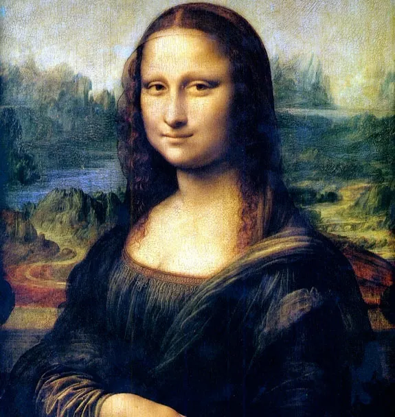
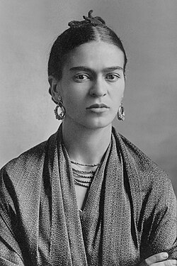
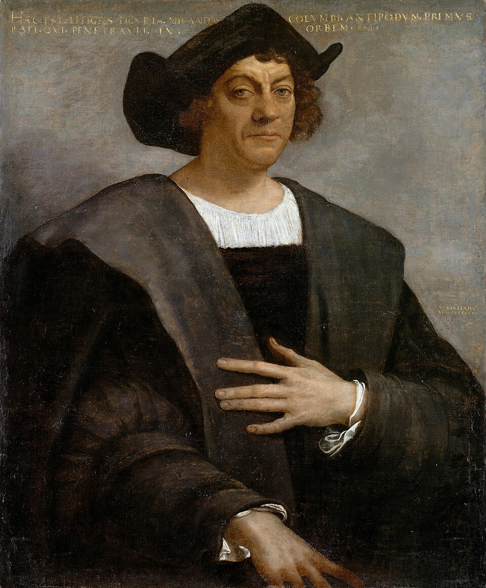
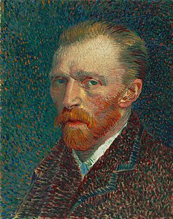
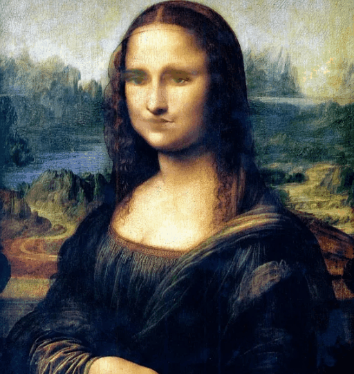

# Práctica 5: Biometría Facial y Reconocimiento de Emociones en Tiempo Real
### Jaime Cuenca Relinque y Daniel Hernández Sánchez

## Requisitos e Instalación

Para reproducir el entorno de ejecución hace falta instalar lo siguiente:

pip install numpy pandas matplotlib opencv-python==4.12.0.88

pip install scikit-learn scikit-image joblib

pip install mediapipe tensorflow tf-keras deepface

## Objetivos del Informe

En este documento presentamos el resumen de la cuarta práctica de la asignatura, orientada a la detección de rostros y la extracción de información facial en tiempo real. Partiendo de los métodos explicados en las prácticas previas, el propósito de este trabajo es aplicar estas herramientas para desarrollar dos prototipos interactivos capaces de reaccionar ante el usuario: uno basado en un modelo propio entrenado para el reconocimiento de emociones y otro de temática libre apoyado en el seguimiento de landmarks faciales.

# Filtro Basado en Modelo

## Objetivos y Enfoque del Apartado

Siguiendo el planteamiento de la práctica, el flujo de trabajo se ha estructurado en tres bloques principales:
1. **Entrenamiento de un modelo biométrico propio:** Adaptación del pipeline de clasificación visto en clase (VC_P5_eigenfaces_handcrafted_kfold) al reconocimiento de **7 expresiones faciales** (*angry, disgust, fear, happy, neutral, sad, surprise*).
2. **Prototipo interactivo en tiempo real:** Adaptación del modelo entrenado con **MediaPipe FaceLandmarker** para generar filtros visuales y sistemas de partículas reactivos según la emoción detectada en vivo.
3. **Estudio comparativo ampliado:** Comparativa de rendimiento, precisión y tiempos de inferencia entre el modelo clásico seleccionado (**HOG + SVM**), una **Red Neuronal Convolucional (CNN)** entrenada desde cero y el modelo preentrenado **DeepFace.analyze**.

## Arquitectura y Desarrollo del Código

### 1. Librerías y Extractores de Características
Antes de meternos con redes neuronales pesadas, probamos primero con los descriptores clásicos vistos en clase.

* **LBP (*Local Binary Patterns* — lbphist y GetLBP):** Siguiendo el enfoque visto en clase, dividimos cada rostro en una cuadrícula regular de celdas y calculamos patrones binarios locales comparando cada píxel con sus 8 vecinos. Al emplear el método uniforme, concatenamos los histogramas espaciales para capturar las microtexturas de la piel y pequeñas arrugas de expresión (como las que se forman alrededor de los ojos al sonreír o en el entrecejo al fruncir el ceño).
* **HOG (*Histogram of Oriented Gradients* — GetHOG):** Complementando la textura, aplicamos el descriptor HOG sobre la misma rejilla espacial. Este bloque resulta clave porque resume la dirección e intensidad de los bordes, permitiéndonos modelar de forma robusta la geometría macroscópica de los rasgos faciales —la curvatura de la boca, la apertura ocular o la inclinación de las cejas— con gran tolerancia a cambios leves de iluminación.
* **Normalización, Búsqueda de Hiperparámetros y Clasificación (GetPredictions y GetPredictionsandProbs):** Adaptamos las funciones de entrenamiento y evaluación de clase para construir un flujo completamente automatizado:
  * **Escalado estricto:** Antes de entrenar, normalizamos los vectores de características al rango $[0, 1]$ mediante MinMaxScaler (ajustándolo únicamente sobre el conjunto de entrenamiento para evitar cualquier fuga de datos hacia el test).
  * **Ajuste automático con SVM:** optimizamos los hiperparámetros (C entre $100$, $5000$ y gamma entre $0.0001$ y $0.01$) mediante validación cruzada interna de 5 particiones (GridSearchCV).
  * **Compensación de desequilibrios y soporte para *Ensemble*:** Dado que en los datasets de emociones reales algunas clases (como disgust) cuentan con menos muestras que otras, activamos class_weight='balanced' para penalizar proporcionalmente los errores en las clases minoritarias. Además, la variante GetPredictionsandProbs habilita la calibración probabilística (probability=True), permitiéndonos extraer las probabilidades de pertenencia a cada emoción tanto para alimentar el modelo *Ensemble* (*Stacking*) como para su posterior fusión en tiempo real.

### 2. Carga y Exploración del Dataset
En esta celda preparamos todo el conjunto de datos de entrenamiento siguiendo el mismo esquema matricial que vimos en los notebooks de clase (VC_P5_eigenfaces y VC_P5_eigenfaces_handcrafted_kfold), pero adaptado a nuestras **7 emociones** (datasetemocionesdistintos/train).

#### ¿Qué hace exactamente la función LoadDataset?
1. **Lectura ordenada y etiquetado automático:** Recorre en orden alfabético cada subcarpeta dentro de train (angry, disgust, fear, happy, neutral, sad, surprise), guardando sus nombres en classlabels y asignando automáticamente un índice numérico incremental (0, 1, 2...) a cada emoción en el vector Y.
2. **Control del desbalanceo (max_por_clase=500):** Aunque el directorio completo en disco supera las 7.000 imágenes, en los datasets de emociones suele haber muchas más fotos de *happy* o *neutral* que de *disgust*. Para evitar que el clasificador se sesgue hacia las clases mayoritarias y para mantener tiempos de entrenamiento razonables en CPU, limitamos la carga a un máximo de **500 muestras por clase** (quedando un conjunto equilibrado de hasta 3.500 imágenes).
3. **Normalización espacial y aplanado (flatten):** Cada archivo .jpg se carga directamente en **escala de grises** (cv2.IMREAD_GRAYSCALE), se redimensiona a una resolución estándar de **$48 \times 48$ píxeles** y se aplana en un vector fila de **2.304 características** ($48 \times 48 = 2.304$). Al terminar, obtenemos la matriz X (de tamaño n_samples × 2304, convertida a float32) y el vector de etiquetas Y (float64).

#### Comprobación numérica y visual
* **Estadísticas por consola:** Antes de pasar a extraer descriptores, imprimimos el número total de muestras cargadas, la dimensión de cada vector (2.304), el número de clases (7) y el recuento exacto de imágenes por emoción (samples per class) para verificar que el reparto está equilibrado.
* **Muestreo visual con Matplotlib:** Por último, recorremos las 7 clases y dibujamos una cuadrícula con **3 imágenes por emoción** (reconstruyendo cada vector de 2.304 valores de vuelta a $48 \times 48$ con .reshape(height, width)). Esto nos sirve como control de calidad rápido para asegurarnos de que las etiquetas coinciden con las caras y que no se ha colado ninguna imagen corrupta o mal recortada.

### 3. Validación Cruzada y Comparativa de Modelos Clásicos
Antes de quedarnos con un modelo definitivo, en esta celda montamos un experimento completo para comprobar qué descriptor visual y qué clasificador funcionan mejor con nuestro dataset de emociones.

#### ¿Cómo se organiza la prueba?
En lugar de hacer una única división aleatoria (que podría dar mejor o peor resultado por pura suerte), utilizamos **5-Fold Cross-Validation estratificado (StratifiedKFold, $k=5$)**. Esto divide el dataset en 5 bloques manteniendo exactamente la misma proporción de cada emoción en todos ellos: en cada vuelta el modelo entrena con el **80%** de las caras y se examina con el **20%** restante, repitiendo el proceso 5 veces hasta que todas las imágenes han pasado por test.

1. **Píxeles + KNN ($k=5$):** Es nuestro punto de partida más básico. Le pasamos al clasificador los 2.304 niveles de gris en bruto de la foto y decide la emoción buscando las 5 caras más parecidas del entrenamiento. Sirve como referencia base para ver cuánto mejoramos al extraer características inteligentes.
2. **PCA (95% varianza) + KNN:** En lugar de usar los 2.304 píxeles sueltos, aplicamos Análisis de Componentes Principales (*Eigenfaces*) ajustado únicamente sobre los datos de entrenamiento (PCA(0.95)) para quedarnos con las componentes principales que explican el 95% de la información de la cara, eliminando ruido antes de aplicar los 5 vecinos más cercanos.
3. **PCA (95% varianza) + SVM:** Aprovechamos esas mismas componentes principales comprimidas, pero cambiamos KNN por una Máquina de Vectores Soporte (GetPredictions) capaz de trazar fronteras curvas (kernel RBF) que separan mucho mejor las distintas expresiones.
4. **HOG + SVM (rejilla 6×6):** Calculamos los histogramas de gradientes orientados dividiendo cada rostro de $48\times48$ en $6\times6$ celdas (36 celdas de $8\times8$ píxeles). Al centrarse en la dirección de los bordes y contornos clave (cejas, ojos y boca) e ignorar cambios de iluminación, combinado con el SVM logra el mejor rendimiento global.
5. **LBP + SVM (rejilla 4×4):** Dividimos la cara en $4\times4$ celdas (16 celdas de $12\times12$ píxeles) y comparamos cada píxel con sus 8 vecinos (nri_uniform) para capturar texturas y arrugas de expresión en la piel, entrenando después otro clasificador SVM.
6. **Ensemble / Stacking (Clasificador combinado):** Por último, probamos a juntar lo mejor de cada mundo. Obtenemos las probabilidades de pertenencia a cada una de las 7 emociones que predicen por separado PCA+SVM, HOG+SVM y LBP+SVM (GetPredictionsandProbs), las pegamos una al lado de otra (np.hstack) formando un vector de 21 probabilidades, y entrenamos un cuarto clasificador SVM de segundo nivel que toma la decisión final combinando la "opinión" de los tres modelos anteriores.

#### ¿Qué apartados analizamos para decidir cuál es el mejor modelo?
Para no elegir a ciegas y justificar la decisión con datos reales, evaluamos cuatro aspectos clave al terminar los 5 *folds*:

* **Precision y Recall medios (Mean Precision y Mean Recall):** Calculamos la media de los 5 *folds* ponderada por clase (average='weighted') para comprobar tanto la fiabilidad del modelo cuando predice una emoción (*Precision*) como su capacidad para detectar todas las muestras reales de cada expresión sin dejarse ninguna atrás (*Recall*).
* **Estabilidad entre particiones:** Al promediar los 5 *folds* nos aseguramos de que el rendimiento sea constante y no dependa de una partición concreta favorable.
* **Rendimiento por emoción (classification_report):** En la primera vuelta (fold == 1) sacamos el informe detallado de HOG+SVM y del Ensemble para ver el *f1-score* individual de cada una de las 7 emociones, comprobando que el modelo no acierte solo en las expresiones más fáciles (como *happy* o *surprise*) dejando abandonadas las más sutiles.
* **Análisis de errores (confusion_matrix) y coste en tiempo real:** Revisamos la matriz de confusión para detectar qué parejas de emociones se confunden más entre sí (por ejemplo, *miedo* frente a *sorpresa* o *triste* frente a *neutral*). Finalmente, aunque el Ensemble ofrece métricas muy competitivas, elegimos **HOG + SVM** como modelo final porque alcanza prácticamente la misma precisión pero ejecutando **un único extractor y un solo clasificador** por fotograma, evitando multiplicar por tres el tiempo de cómputo en la webcam.

  
   
  <em><b>Figura 1:</b> Matriz de confusión y precisión de Hog + SVM</em>

Tras evaluar los distintos extractores de características y clasificadores mediante validación cruzada estratificada (*Stratified 5-Fold Cross-Validation*), se extraen las siguientes conclusiones técnicas:

* **Superioridad de los descriptores locales frente a métodos globales:** Los enfoques basados en textura y gradientes locales superan claramente a la reducción de dimensionalidad global (PCA + SVM, con un **28.4%** de sensibilidad media). Los mejores resultados en validación cruzada corresponden a **LBP + SVM** (**37.7%** de sensibilidad y **36.6%** de precisión) y al **Ensemble** (**36.8%**), seguidos muy de cerca por **HOG + SVM** (**34.4%** de sensibilidad y **33.5%** de precisión).
* **Justificación de HOG + SVM para producción en tiempo real:** Aunque LBP + SVM obtiene ~3 puntos porcentuales más sobre imágenes estáticas de $48\times48$ píxeles, se selecciona **HOG + SVM** para el prototipo final por tres motivos clave:
  * **Robustez frente a ruido e iluminación:** Al capturar la geometría de los contornos (cejas, ojos y boca) mediante histogramas de gradientes orientados, es mucho menos sensible al ruido de sensor y cambios de luz en webcam que la micro-textura de píxeles de LBP.
  * **Eficiencia computacional:** Evita multiplicar por 3 el coste de inferencia del modelo Ensemble, manteniendo tiempos de respuesta de **~1 ms por frame**.
  * **Estabilidad híbrida:** Combinado en tiempo real con los *blendshapes* geométricos de **MediaPipe**, compensa las limitaciones de resolución del dataset original.
* **Comportamiento por emoción:** El clasificador alcanza un **34% de acierto global** (más del doble del azar en 7 clases), acertando bastante bien en gestos marcados como **disgust** (64% de *recall*), **happy** (44%) y **surprise** (50% de *precision*), mientras que presenta mayor confusión en emociones sutiles como **sad** (14%) y **neutral** (27%) debido a la baja resolución de las muestras de entrenamiento ($48\times48$ px).

  
   
  <em><b>Figura 2:</b> Precisión media y sensibilidad media de los modelos entrenados.</em>

### 4. Entrenamiento Final y Exportación del Modelo
* **Transición de validación a producción (80/20 $\rightarrow$ 100%):** Durante la fase experimental anterior (*5-Fold Cross-Validation*), el conjunto de datos se dividía en particiones del **80% para entrenamiento y 20% para validación** en cada iteración con el fin de evaluar objetivamente qué descriptor y clasificador generalizaban mejor sin sobreajuste. Una vez comprobado que **HOG + SVM** ofrece el mejor equilibrio entre precisión y velocidad de inferencia, se descartan las particiones de prueba y se entrena el modelo definitivo utilizando el **100% de las muestras disponibles** para maximizar su capacidad de aprendizaje antes de llevarlo a tiempo real.
* **Ajuste y serialización:** Se realiza una búsqueda de los mejores hiperparámetros (GridSearchCV sobre C y gamma) activando probability=True y class_weight='balanced'. Finalmente, el normalizador (MinMaxScaler), el clasificador entrenado (SVC), las etiquetas y las dimensiones de la rejilla ($6\times6$, $48\times48$) se empaquetan mediante joblib en el archivo **modelo_emociones_hog.pkl**.

### 5. Prototipo 1: Filtro Biométrico Reactivo en Tiempo Real

Para llevar el modelo fuera del entorno estático de pruebas y comprobar su rendimiento real frente a una cámara web, desarrollamos una aplicación interactiva en **Python** apoyada en **OpenCV** y **MediaPipe**. El objetivo principal fue lograr una experiencia fluida a más de 30 FPS en CPU, evitando el parpadeo típico de las predicciones fotograma a fotograma.

El flujo de procesamiento de cada fotograma sigue tres etapas bien diferenciadas:

#### 1. Localización geométrica y seguimiento facial
En cada captura de la cámara, el módulo FaceLandmarker de MediaPipe (configurado en modo LIVE_STREAM para minimizar la latencia) detecta el rostro y extrae **478 puntos clave (*landmarks*)** junto con sus *blendshapes* musculares. A partir de las coordenadas extremas de la malla facial, recortamos la región de interés aplicando un **margen superior adicional del 22%**. Este ajuste resultó fundamental durante las pruebas: MediaPipe delimita el rostro hasta las cejas, mientras que el dataset de entrenamiento (FER-2013 / CK+48) incluye la frente completa; sin ese margen, el descriptor perdía contexto espacial y degradaba su acierto.

#### 2. Extracción de características y preprocesado coherente
La región recortada se convierte a escala de grises y se redimensiona a $48\times48$ píxeles, replicando exactamente las condiciones del entrenamiento (evitando ecualizaciones artificiales que alteren los gradientes). Sobre esa matriz calculamos el descriptor **HOG** (8 orientaciones, normalización L1), lo escalamos con el MinMaxScaler serializado en modelo_emociones_hog.pkl y obtenemos el vector de probabilidades inicial de nuestro clasificador **SVM**.

#### 3. Inferencia híbrida: fusión HOG+SVM y *Blendshapes*
Al probar únicamente el modelo clásico sobre vídeo en directo, observamos cierta inestabilidad ante giros leves de cabeza o cambios de iluminación. Para resolverlo, diseñamos una **fusión ponderada** entre la predicción estadística del SVM y la geometría muscular en tiempo real que proporciona MediaPipe:
* Se extraen métricas clave de expresión como la elevación de comisuras (mouthSmile), el fruncido del ceño (browDown), la apertura mandibular (jawOpen), la elevación interior de cejas (browInnerUp) o el arrugado nasal (noseSneer).
* Estas señales refuerzan de manera proporcional las probabilidades correspondientes de las 7 clases (y estabilizan la clase neutral cuando la actividad facial global es baja), normalizando posteriormente el vector para mantener una distribución coherente al 100%.

### 6. Comparativa entre modelos: Clásico vs. CNN vs. DeepFace

Para cubrir los apartados extra de la práctica, en esta última celda hemos montado una comparativa directa entre tres formas muy distintas de resolver el mismo problema: nuestro modelo clásico (**HOG + SVM**), una **Red Neuronal Convolucional (CNN)** entrenada desde cero y **DeepFace**, que ya viene preentrenado.

#### ¿Cómo se ha hecho la prueba?
Para que la comparación sea justa, todos los modelos se han evaluado exactamente con las mismas imágenes usando una única partición **80% entrenamiento / 20% test** (random_state=42). Además de mirar cuánto aciertan (*Accuracy*, *Precision* y *Recall*), hemos medido el **tiempo de entrenamiento** y lo que tarda cada uno en predecir una sola imagen (**ms/img**), que al final es lo que decide si sirve o no para la webcam en tiempo real.

#### Los tres enfoques comparados

1. **Modelo A — Clásico (HOG + SVM):**
   * **Cómo funciona:** Usa los descriptores HOG ($6\times6$ celdas) que ya habíamos calculado, normaliza los valores entre 0 y 1 con MinMaxScaler y entrena una SVM con kernel RBF (C=1000, gamma=0.001) compensando el peso de las clases (class_weight='balanced').
   * **Qué tal va:** Como trabaja directamente con los bordes y formas de la cara ya resumidos en un vector pequeño, en CPU se entrena en apenas unos segundos y predice cada foto en **menos de 1 milisegundo**. Para tiempo real sin gráfica dedicada es con diferencia el más práctico.

2. **Modelo B — Red Neuronal Convolucional propia (CNN en Keras/TensorFlow):**
   * **Preparación:** A diferencia de la SVM, la CNN necesita conservar la forma cuadrada de la imagen, así que pasamos los datos a formato (48, 48, 1) y dividimos los píxeles entre 255.0 para dejarlos entre 0 y 1.
   * **Arquitectura:** Hemos montado una red secuencial ligera con **3 bloques convolucionales** (de 32, 64 y 128 filtros de $3\times3$) intercalando BatchNormalization para estabilizar el aprendizaje, MaxPooling2D para ir reduciendo el tamaño de la imagen y Dropout (0.25 y 0.4) para evitar que memorice los datos de entrenamiento. Al final lleva una capa densa de 128 neuronas y la salida softmax para las 7 emociones.
   * **Qué tal va:** Se ha entrenado durante **20 épocas** con Adam. Aquí la red aprende sus propios filtros directamente desde los píxeles sin que le demos pistas como HOG o LBP, pero tarda bastante más en entrenar y necesita muchos datos para no sobreajustar.

3. **Modelo C — Modelo preentrenado (DeepFace.analyze):**
   * **Adaptación:** Como DeepFace espera fotos a color, reconstruimos las caras de $48\times48$ y las pasamos a 3 canales BGR. Además, activamos enforce_detection=False para que no dé error ni intente recortar de nuevo unas imágenes que ya son caras recortadas, y le pedimos solo las emociones (actions=['emotion']) para ahorrar tiempo.
   * **Qué tal va:** Como analizar miles de fotos en CPU con DeepFace es muy lento, se ha probado sobre una muestra de **150 imágenes** del test. Su ventaja es que no hay que entrenarlo (0.0 s), pero en inferencia es **muchísimo más lento** por imagen que HOG + SVM y que nuestra CNN, así que meterlo fotograma a fotograma en la webcam haría que el vídeo fuese a tirones.

  
   
  <em><b>Foto 7:</b> Comparativa de rendimiento (Accuracy, Precision, Recall) y tiempos de entrenamiento e inferencia entre HOG + SVM, Red Neuronal (CNN) y DeepFace.analyze.</em>

Al comparar los tres enfoques, vemos que tanto nuestro modelo clásico (**HOG + SVM**, con un **34.3%** de *Accuracy*) como la **CNN** entrenada desde cero (**31.8%** de *Accuracy* y **38.3%** de *Precision*) duplican con creces el azar (~14.3% en 7 clases). Esto demuestra que, con un dataset reducido (~500 imágenes por clase a $48\times48$ píxeles), una red convolucional no tiene suficientes datos para superar a un buen descriptor de bordes, pero con una diferencia enorme en tiempo de cómputo: **HOG + SVM se entrena en apenas 1.39 s frente a los 79.26 s de la CNN en CPU**. 

Por su parte, **DeepFace.analyze** da un salto hasta el **74.7% de Accuracy** (y **77.8% de Precision**) sin coste de entrenamiento (0.00 s) gracias a venir preentrenado con decenas de miles de rostros reales; sin embargo, su tiempo de inferencia de **36.66 ms por imagen** (más de **50 veces más lento** que los 0.669 ms de HOG + SVM) haría que la webcam fuese con retardo en CPU, dejando claro que para lograr fluidez en tiempo real sin gráfica dedicada compensa priorizar la velocidad de HOG + SVM.

# Filtro con Tematica Libre

## Objetivos y Enfoque del Apartado

Para finalizar se presenta la propuesta de filtro libre, donde debíamos provocar reacciones a partir de la información extraída del rostro. Al igual que en el apartado anterior se ha elegido MediaPipe (*FaceLandmarker*) por su precisión y baja latencia localizando landmarks en tiempo real, permitiendo segmentar de forma independiente regiones concretas como los ojos y la boca sin comprometer la fluidez de la captura.

El concepto elegido para este segundo escenario es **"Museo Vivo"**, una aplicación interactiva que traslada las expresiones faciales del usuario en directo sobre retratos (*La Mona Lisa*, *Frida Kahlo*, *Cristóbal Colón* y *Van Gogh*). El objetivo no es superponer una máscara rígida sobre toda la cara, sino crear regiones de interes alrededor de los ojos y la boca y transladarlos a la pintura.

**Selección estratégica de retratos:** Se han priorizado obras con iluminación uniforme y orientación frontal para que el correcto funcionamiento del codigo.

| 1. La Mona Lisa | 2. Frida Kahlo | 3. Cristóbal Colón | 4. Van Gogh |
| :---: | :---: | :---: | :---: |
|  |  |  |  |

### Arquitectura e Implementación del Filtro

Para garantizar fluidez en tiempo real, el funcionamiento del prototipo se divide en dos fases diferenciadas: una **etapa de precarga estática** y un **bucle de inferencia y fusión en vivo**.

#### 1. Precarga y calibración del carrusel de obras
Antes de iniciar la captura de vídeo, el sistema procesa una única vez las imágenes del catálogo (*La Mona Lisa*, *Frida Kahlo*, *Cristóbal Colón* y *Van Gogh*) ejecutando `MediaPipe FaceLandmarker` en modo `IMAGE`. A partir de los 478 puntos clave detectados, se extraen las regiones de interés (ROIs) correspondientes a ambos ojos y a la boca mediante `obtener_bbox`. Dado que cada pintura presenta proporciones y perspectivas ligeramente distintas, cada obra cuenta con parámetros individuales de escala y desplazamiento (`ajustar_bbox`) que dejan precalculadas las coordenadas exactas de destino sobre el lienzo.

#### 2. Extracción y fusión cromática en tiempo real
Durante la ejecución en directo (modo `VIDEO`), se localizan las mismas regiones faciales sobre el fotograma de la webcam y se transfieren al cuadro mediante la función `integrar_rasgo`, que resuelve el choque visual entre la cámara y el óleo en dos pasos:

* **Igualación estadística en espacio CIELAB:** A diferencia del espacio RGB, CIELAB desacopla la luminosidad ($L^*$) de los canales cromáticos ($a^*$ verde-rojo y $b^*$ azul-amarillo). El algoritmo calcula la media ($\mu$) y desviación estándar ($\sigma$) de cada canal en el recorte de la webcam y las reescala para igualar la distribución de color de la región destino del cuadro, mezclando posteriormente un `65 %` de la imagen adaptada con un `35 %` del recorte original para conservar la naturalidad de los rasgos.
* **Clonación sin costuras mediante ecuaciones de Poisson (`cv2.seamlessClone`):** Sobre una máscara elíptica suavizada, se aplica edición basada en gradientes (`cv2.NORMAL_CLONE`). En lugar de copiar píxeles directos, el método preserva los gradientes internos del usuario (iris, párpados, comisuras) mientras fuerza una transición continua con los píxeles del contorno del óleo, eliminando bordes visibles y adaptando las sombras locales.

### 3. Controles

| Tecla | Acción |
|---|---|
| **D** o **Espacio** | Siguiente obra |
| **A** | Obra anterior |
| **ESC** | Salir y liberar la cámara |

#### 4. Resultados 

Como se muestra en la demostración adjunta, el sistema permite alternar dinámicamente entre las cuatro obras manteniendo una sincronización fluida. 

### 5. Limitaciones observadas

**Sensibilidad a la rotación de la cabeza:** Al utilizar recortes rectangulares alineados a los ejes los giros de cabeza provocan desalineaciones entre los ojos de la webcam y la orientación fija del retrato.
**Condiciones de iluminación extrema:** Aunque la transferencia en espacio LAB compensa diferencias moderadas de tono y brillo, una iluminación muy intensa o sombras dificultan su funcionamiento.